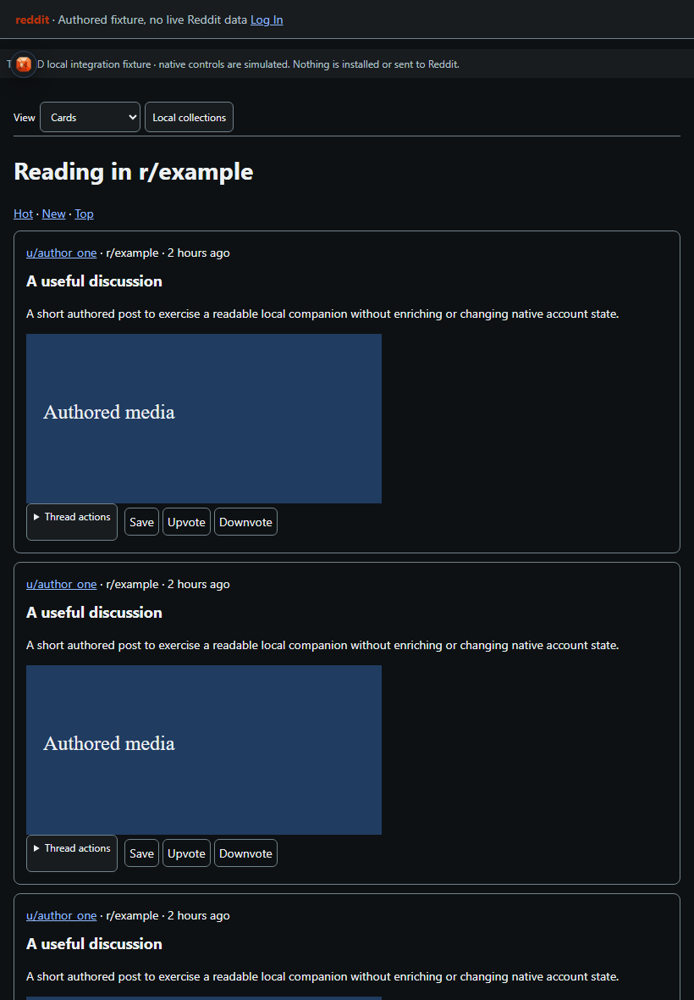
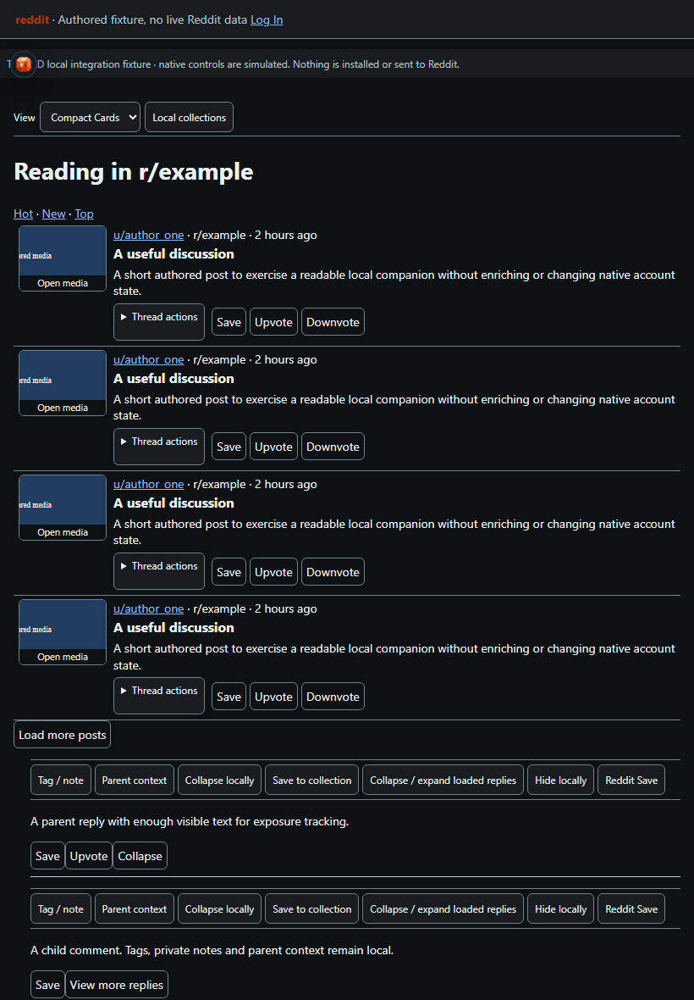
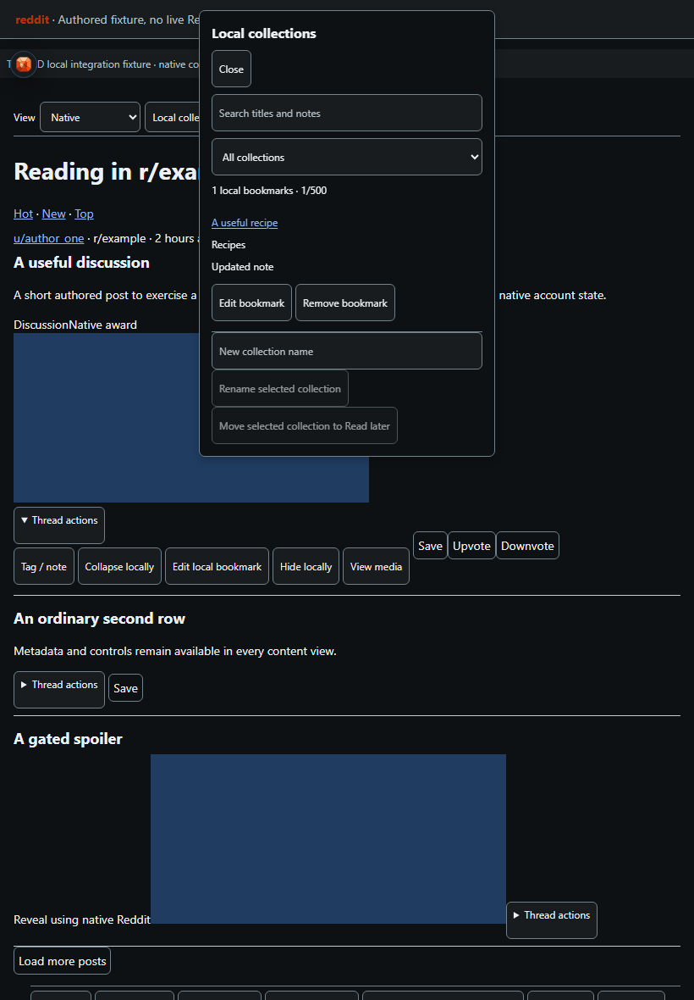
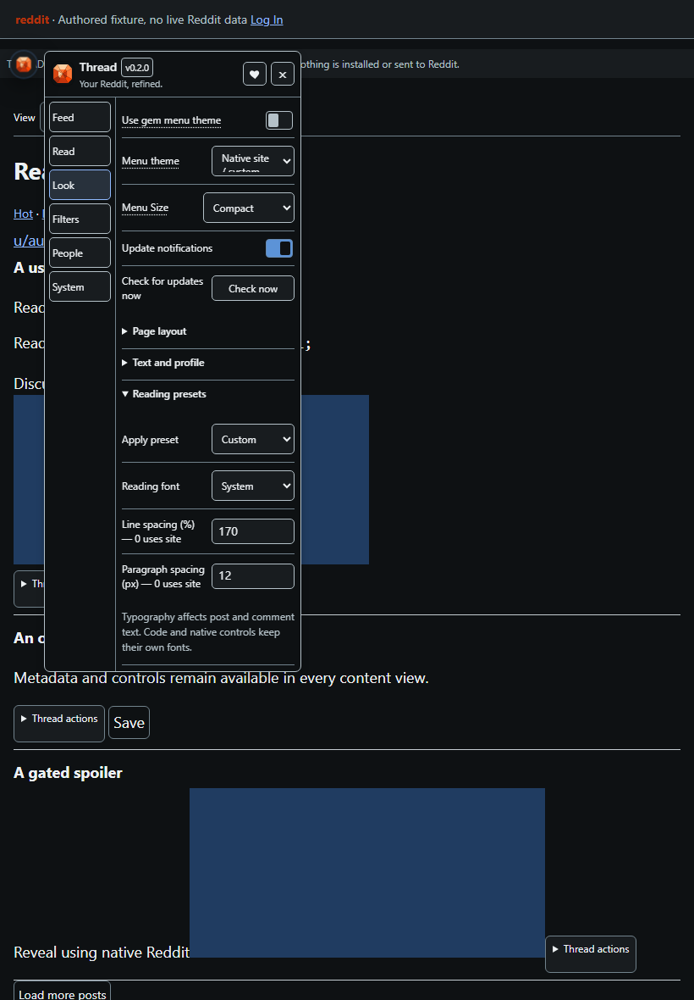

# Thread for Reddit

**Your Reddit, refined.**

## Get started

1. Install a userscript manager such as [Violentmonkey](https://violentmonkey.github.io/get-it/) or [Tampermonkey](https://www.tampermonkey.net/).
2. [Install Thread for Reddit](https://github.com/ExtraPotions/Thread/releases/latest/download/thread.user.js) and confirm in your userscript manager.
3. Refresh modern Reddit and open the Thread gem below the left navigation rail's collapse handle. With other ExtraPotions products installed, they share one launcher: open it and choose Thread.

## What you can do

- **Choose your layout:** keep Reddit's Native view or use Cards, Compact Cards or Grid. The feed strip scrolls with the page, leaving Reddit's Sort By controls accessible. Saved List preferences use Compact Cards.
- **Read media comfortably:** use thumbnail previews in Compact Cards and open full media when you want it. Opened images and embedded players fit the post width while keeping the original player controls.
- **Filter your feed:** hide, dim or blur matching posts and comments with reversible local rules.
- **Keep private notes:** add local author tags, notes and nicknames. Personal records stay paused when your account cannot be identified reliably.
- **Navigate discussions:** jump between loaded comments, return to a reading position and track unread comments when local read tracking is enabled. Jump targets do not filter comments or search unloaded replies.
- **Keep a local reading library:** save posts and comments into collections with private notes, search, rename and removal Undo. Your local library is separate from Reddit Saved.
- **Browse fresh posts:** optionally track read posts, hide them and undo the last read change. Scroll-based marking is a separate option.
- **Tune your reading:** apply Comfortable, Dense or Book typography, then adjust font, line spacing and paragraph spacing independently.
- **Choose the menu look:** enable **Look → Use gem menu theme** for Thread's orange palette. It starts off and colors the menu and notices.

Compact Cards shows thumbnail-and-text rows with two-line previews and a **Thread actions** disclosure. Full media stays collapsed until you choose **Open media** or Reddit's existing expand control. Opened images and players keep their full readable layout. Enable **Feed → Post presentation → Expand long text** to show the full text.

On touch devices, **Thread actions** sits to the left of Reddit's post controls in every feed view. The row wraps when space is tight, and opening Thread actions keeps Reddit's controls accessible.

Native galleries retain Reddit's slide sizing and navigation. **View media** shows one image per gallery slide in order, without feed thumbnails or decorative background copies.

Previews recover when Reddit refreshes a post or loads its media later. Hide, blur and collapse also apply to media previews. **Close media** pauses native audio/video; embedded providers keep their own playback controls.

Use **Save to collection** in Thread actions, or beside a comment. Open **Local collections** in the page strip or **Read → Local collections** to manage up to 500 bookmarks. Settings export/import includes this library; private notes stay in your local userscript storage until you export them.

Enable **Feed → Read posts → Track read posts locally** to mark posts when opening them or using **Mark read**. **Hide read posts**, **Show read posts** and **Undo read change** stay in the feed strip. Optional scroll marking requires 60% visibility for 1.2 seconds in the foreground. Read markers expire with the configured history/visit retention period.

On discussion pages, use **Next top-level thread**, **Next sibling comment** or **Collapse / expand loaded replies** while keeping the parent available. **Search loaded comments** outlines matching comments and offers Previous/Next; hidden, collapsed, gated and unloaded content is excluded.

Choose **Look → Reading presets** for typography. **Feed → Read posts → Restore feed position locally** can return to a loaded post and its screen offset. It respects an already-restored browser position and stops after a bounded wait if the saved post is unavailable. It does not load missing feed pages.

Account switching and Reddit API enrichment are unavailable. See [development](docs/development.md) for supported behavior and verification limits.

## See it in action

<table>
  <tr>
    <td width="50%" valign="top" align="center"> <strong>Cards on iPad</strong></td>
    <td width="50%" valign="top" align="center"> <strong>Compact Cards on iPad</strong></td>
  </tr>
</table>

Screenshots use sample content.

<table>
  <tr>
    <td width="50%" valign="top" align="center"> <strong>Local collections</strong></td>
    <td width="50%" valign="top" align="center"> <strong>Reading presets</strong></td>
  </tr>
</table>

Layout captures use iPad portrait dimensions with touch emulation. They show the built userscript on authored sample pages, not an installed iPad browser.

All ExtraPotions menus share the same Core template. Open **System** for status, diagnostics, troubleshooting and Reset. Donations remain in the header heart.

## Support

[Support development](https://ko-fi.com/expdare). Donations are optional. All features remain available without donating.

## License

**Code:** [PolyForm Noncommercial License 1.0.0](LICENSE-CODE.md) 
**Artwork and documentation:** [CC BY-NC-SA 4.0](LICENSE-ASSETS.md)

Thread is an independent project and is not affiliated with or endorsed by Reddit.
