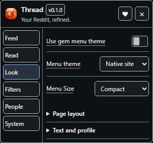
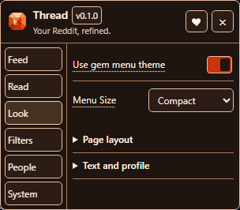

# Thread

**Your Reddit, refined.**

Reading, layout and filtering tools for modern Reddit by expDARE. The suite header is **Thread**, with the selected orange **Asscher** gem. This candidate is unpublished and has not replaced the previously installed build.

Choose Cards, Compact Cards, Grid or List, filter posts/comments reversibly, keep private author tags/notes and navigate loaded discussions. Thread uses the actual shared ExtraPotions Core launcher and menu. Native account actions remain deliberate. Account switching is deferred.

The small sticky feed strip holds the current content view and optional pinned/sort shortcuts. Sidebar settings and temporary collapse actions live in **Feed → Sidebars**. **Back to top** appears separately at the page edge after scrolling. Previous/Next controls appear only on discussion pages: All, OP, Moderator, Tagged and Unread choose **loaded comment jump targets**, without filtering comments or searching unloaded replies. Unread requires local read tracking.

Signed-in identity is detected from Reddit's native account components and canonical header profile links, without an API call. If those markers disagree or are unavailable, personal records stay isolated until identity is known. Basic view/layout tools remain available. Account switching itself remains deferred.

The **Use gem menu theme** switch in Look is **off by default**. It colors only Thread's menu and notices. The normal menu follows native site/system colors; SHIFT keeps its page-theme role.

Open Thread from the circular gem button below the left navigation rail's collapse handle. Its diameter follows the native handle (32px on the inspected Reddit interface). The menu opens beside that anchor; narrow or missing rails retain a contained, reachable fallback. Co-installed products use the suite launcher.

The menu follows the shared Core sidebar template. Feed, Read, Filters, People and Look retain Thread's controls; System contains Status, paired Show/Copy Diagnostics, Settings transfer and Reset. Support and Reset are available only inside System. Setting explanations use contained hover/focus tips. Donations stay in the header heart, separate from troubleshooting. The first-release candidate prepares Report a Problem for the project issue form; public repository creation is pending.

These are captures of the built local userscript on authored fixtures. Current native Reddit DOM inspection confirmed the account-marker and Grid-separator mismatches; the local candidate fixes those contracts and has regression coverage for account isolation, actual wrapper structure, distinct media sizes and native-view restoration. It has not been installed or retested against Reddit's live shadow rendering. Earlier native feed-action visibility and parent-preview findings remain outside this change. Mobile web and long-session performance remain unverified. API enrichment is explicitly unavailable until legitimate independent app access exists.

See [development](docs/development.md) for commands, bounds and limitations, [behavioral scope](docs/behavioral-spec-v3.txt) for the authorized requirements, and [menu verification](../local-verification/thread-menu-fix-20261020/REPORT.txt) for local evidence. No public install link exists.
