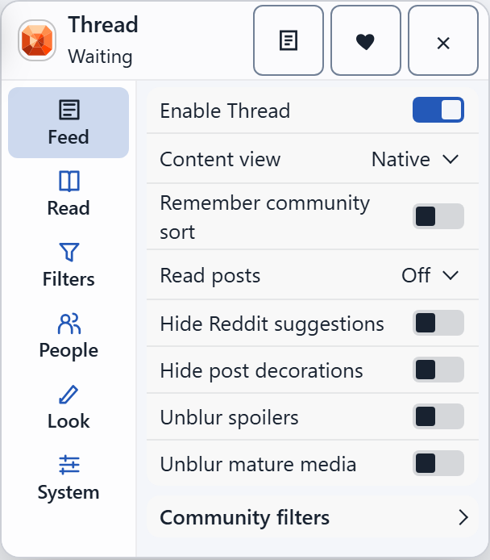
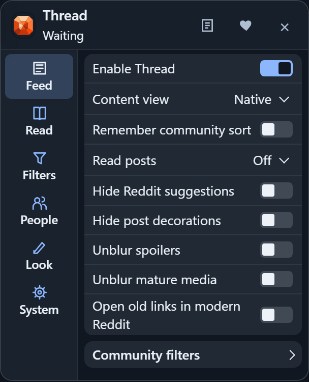
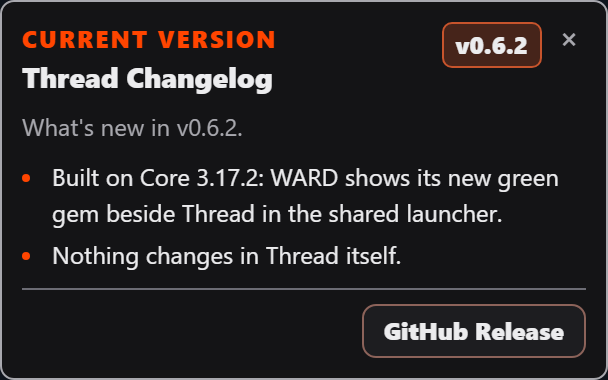

#  Thread for Reddit

Adjust modern Reddit’s layouts, filter your feed and keep a private reading library.

[Install Thread for Reddit](https://github.com/ExtraPotions/Thread/releases/latest/download/thread.user.js) · Requires [Violentmonkey](https://violentmonkey.github.io/get-it/) or [Tampermonkey](https://www.tampermonkey.net/).

After installing, refresh modern Reddit and open the Thread gem below the left navigation rail’s collapse handle. [Setup and controls →](docs/usage.md)

## Features

- Choose Native, Cards, Compact Cards or Grid layouts.
- Hide, dim or blur posts and comments with reversible local filters.
- Navigate loaded discussions and optionally mark or hide read posts.
- Keep local collections, author tags, notes and nicknames.

Thread uses native page data. Personal records stay in local userscript storage until you export them, and pause when your account cannot be identified reliably. Local collections are separate from Reddit Saved.

## Screenshots

| Light | Dark | Changelog |
| :---: | :---: | :---: |
|  |  |  |

---

[Usage](docs/usage.md) · [Changelog](CHANGELOG.md) · [Support](https://ko-fi.com/expdare) · [Code license](LICENSE-CODE.md) · [Artwork and documentation license](LICENSE-ASSETS.md)

Donations are optional. All features remain available without donating.

Thread is independent and is not affiliated with or endorsed by Reddit.
Menus use Slate Blue in Light, Dark or System mode. Site themes offer the same three modes.
